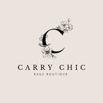
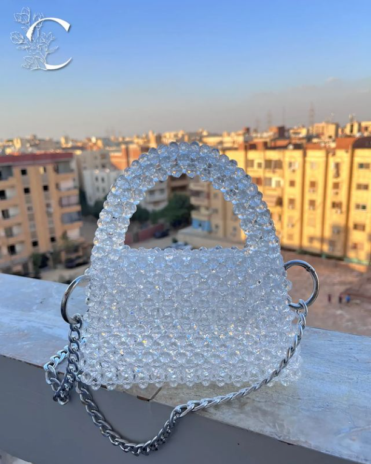
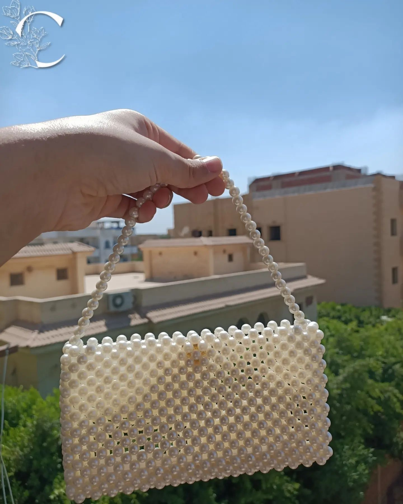
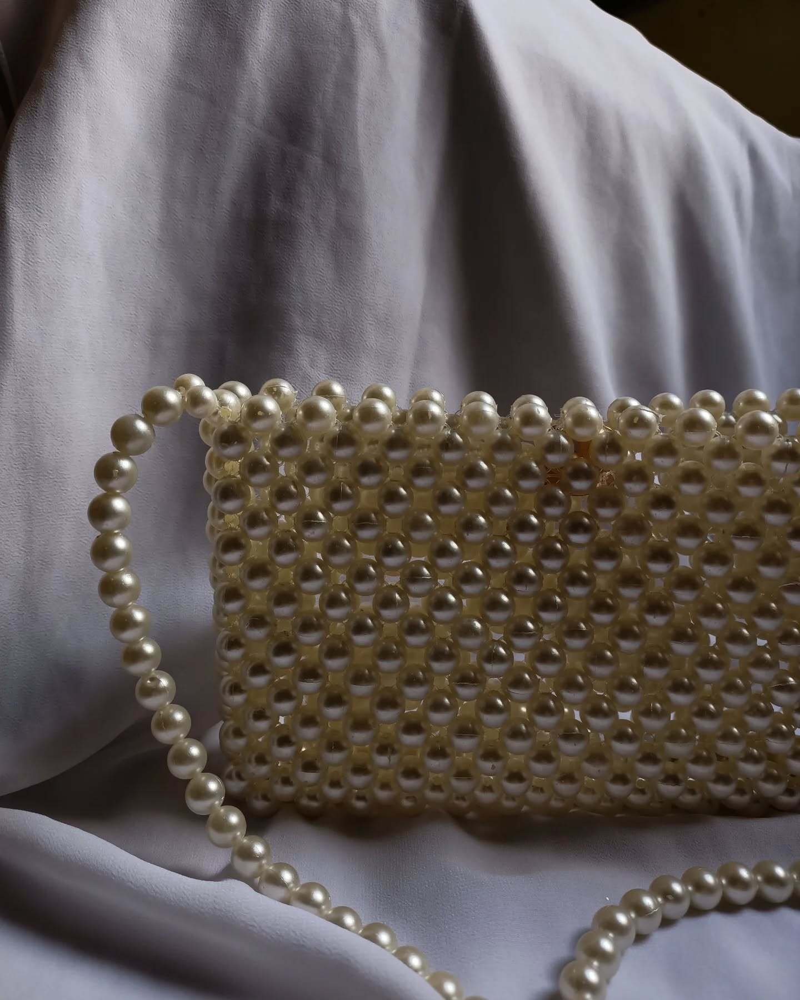
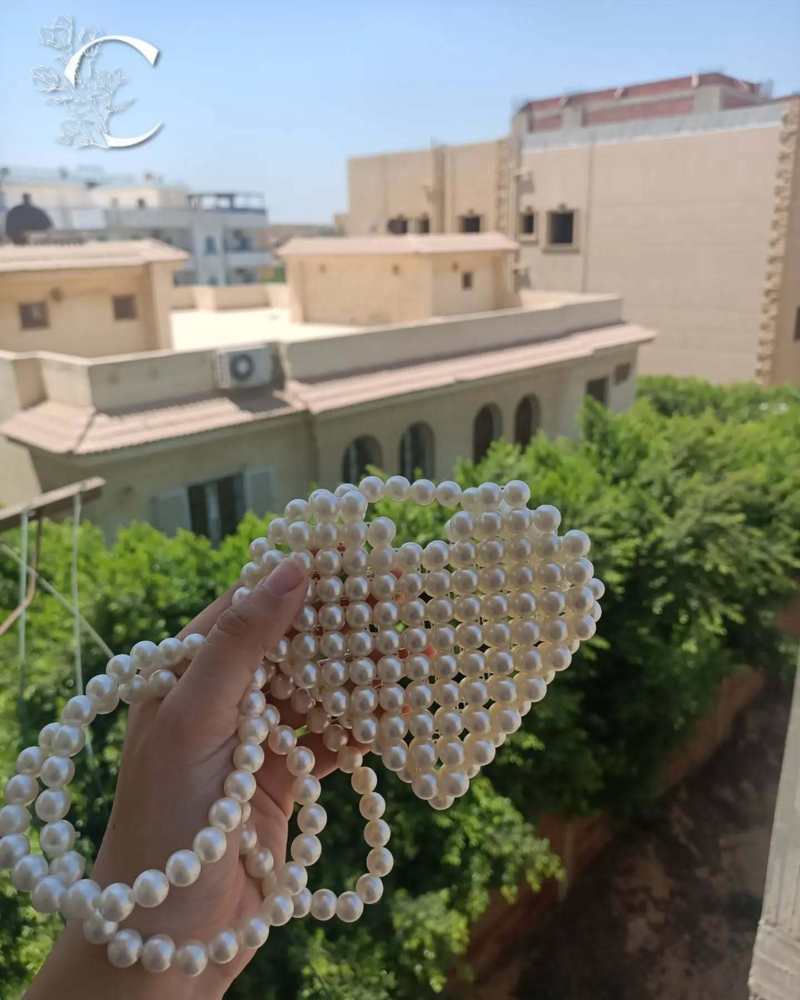
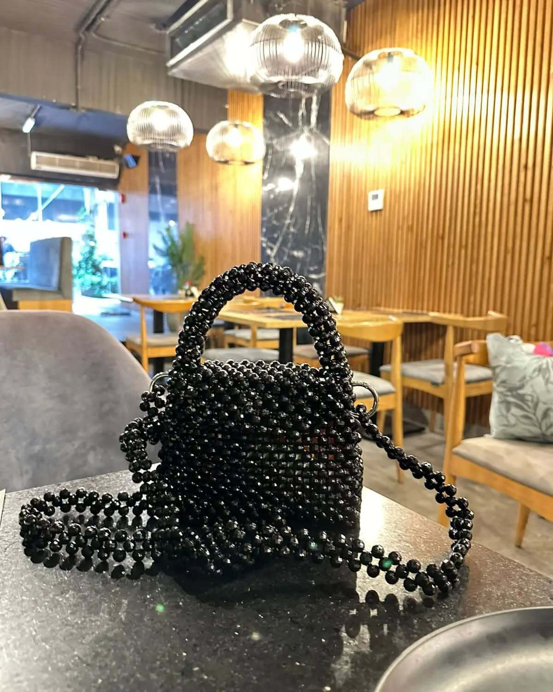
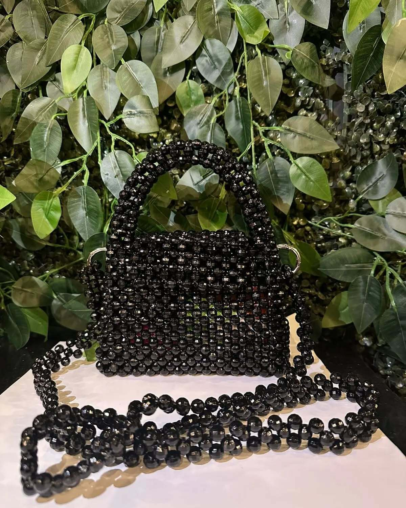

<div align="center">

  

  # 👜 Carry Chic
  ### *The Art of Handcrafted Luxury & Timeless Slow Fashion*

  <p align="center">
    An exclusive e-commerce boutique celebrating bespoke handmade crochet, knit, and woven luxury bags. Every stitch slow-crafted with passion, sustainable organic materials, and haute couture elegance.
  </p>

  [](carrychic.html)
  [](https://www.instagram.com/_carry_chic/)
  [](carrychic.js)
  [](carrychic.html)
  [](carrychic.css)

  <br/>

  <a href="#-key-features">Key Features</a> •
  <a href="#-the-capsule-collection">The Collection</a> •
  <a href="#-quick-start">Quick Start</a> •
  <a href="#-project-architecture">Architecture</a> •
  <a href="#-tech-stack">Tech Stack</a> •
  <a href="#-connect">Connect</a>

</div>

---

## 🌟 Overview

**Carry Chic** is a contemporary slow-fashion luxury bag boutique founded by **Farah Talaat**. Built with pure vanilla technologies (HTML5, CSS3, modern ES6+ JavaScript), the project is engineered to provide an ultra-refined, fluid shopping experience reminiscent of high-end fashion houses.

> *"Fast fashion fills closets; handcrafted passion tells your story."*  
> — **Farah Talaat**, Founder & Creative Artisan

---

## ✨ Key Features

### 💎 Haute Couture Aesthetics
- **Bespoke Color Palette**: Warm alabaster, artisanal espresso, champagne gold accents, and rich textures.
- **Editorial Typography**: Styled with *Cormorant Garamond* for regal headlines and *Plus Jakarta Sans* for modern readability.
- **Micro-Interactions**: Hover image zooms, glowing wishlist toggles, and smooth page transitions.

### 🛍️ Dynamic Shopping Experience
- **Slide-out Cart Drawer**:
  - Live item quantity adjuster (`+` / `-`).
  - Real-time subtotal and shipping calculator.
  - Interactive **Free Shipping Progress Bar** with animated milestone unlocking.
  - Full client-side persistence powered by `localStorage`.
- **Checkout Modal**:
  - Clean order review and customer details collection.
  - **1-Click WhatsApp Instant Order Confirmation**: Automatically formats items, quantities, delivery address, and total into a pre-filled WhatsApp message ready to send to the designer.

### 🎨 Complete Product Suites (6 Masterpieces)
Each bag features a dedicated detail page with:
- Multi-angle gallery with clickable thumbnail switching.
- Interactive color finish swatches.
- Specifications tabs (*Description*, *Materials & Care*, *Shipping & Returns*).
- Recommended complementary pieces (*"You May Also Adore"*).

### 📱 Responsive & Zero-Bloat
- 100% fluid layout across mobile, tablet, and ultra-wide displays.
- Zero heavy frameworks (No React, Vue, or bulky UI libraries) — loads instantly with minimal bundle weight.

---

## 👜 The Capsule Collection

| Preview | Model | Category | Price | Signature Feature |
| :---: | :--- | :--- | :---: | :--- |
|  | **[Classic Artisan Handbag](product.html)** | Knit & Crochet | **$120** | Braided organic rope & reinforced handles |
|  | **[Modern Chic Carry Bag](product2.html)** | Shoulder Bag | **$145** | Architectural lines & double-wall structure |
|  | **[Boho Artisan Woven Tote](product3.html)** | Bohemian Tote | **$130** | Textured organic weave for work & travel |
|  | **[Vintage Bloom Crossbody](product4.html)** | Crossbody | **$110** | 3D floral relief & adjustable vintage strap |
|  | **[Celestial Pearl Knot Bag](product5.html)** | Evening & Occasion | **$160** | Hand-beaded pearls with Japanese knot closure |
|  | **[Velvet Mirage Chic Clutch](product6.html)** | Luxury Clutch | **$135** | Velvet twisted cord with brass curb chain |

---

## 📂 Project Architecture

```plaintext
Carry-Chic/
│
├── images/                  # Organized asset vault
│   ├── 333.jpg              # Boutique emblem & favicon
│   ├── Bag1.png .. Bag6.jpg # High-resolution product photography
│   └── wallpaper1..2.jpg    # Editorial campaign backgrounds
│
├── carrychic.html           # Flagship homepage
├── index.html               # Production entry & auto-router
├── carrychic.css            # Master luxury design system & variables
├── carrychic.js             # Cart engine, drawer, wishlist & checkout
│
├── product.html             # Product 1 Detail View (Classic Artisan)
├── product2.html            # Product 2 Detail View (Modern Chic)
├── product3.html            # Product 3 Detail View (Boho Woven)
├── product4.html            # Product 4 Detail View (Vintage Bloom)
├── product5.html            # Product 5 Detail View (Celestial Pearl)
├── product6.html            # Product 6 Detail View (Velvet Mirage)
├── product.js               # Gallery switcher, swatches & stepper
│
└── README.md                # Project documentation
```

---

## 🚀 Quick Start

No build steps or package installations are required!

### 1. Clone the repository
```bash
git clone https://github.com/AhmedMohamed2009-lab/Carry-Chic.git
cd Carry-Chic
```

### 2. Launch
Simply open `index.html` or `carrychic.html` in any modern web browser, or serve it with VS Code Live Server:
```bash
# Using VS Code Live Server extension, or:
npx serve .
```

---

## 🛠️ Tech Stack

- **Markup**: Semantic HTML5 (SEO & Accessibility optimized)
- **Styling**: Vanilla CSS3 Custom Properties (Variables, Flexbox, Grid, Glassmorphism)
- **Scripting**: Pure Vanilla JavaScript ES6+ (No external JS dependencies)
- **Typography**: Google Fonts (*Cormorant Garamond* & *Plus Jakarta Sans*)
- **Icons**: Font Awesome 6 Pro / Free CDN

---

## 💬 Connect & Socials

- 📸 **Instagram**: [@_carry_chic](https://www.instagram.com/_carry_chic/)
- 🎨 **Artisan & Founder**: [Farah Talaat](https://www.instagram.com/farah.talaat.f/)
- 💻 **Developer**: [Ahmed Mohamed](https://github.com/AhmedMohamed2009-lab)

---

<div align="center">
  <sub>Handcrafted with pride & passion &copy; 2026 Carry Chic. All rights reserved.</sub>
</div>
